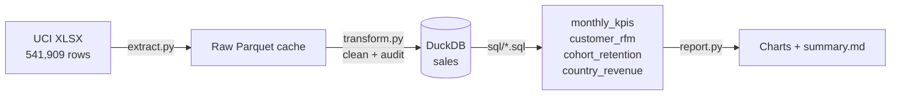

# Retail Customer Analytics


An end-to-end ETL pipeline and customer analysis built on **540K real e-commerce transactions** from a
UK-based online retailer ([UCI Online Retail dataset](https://archive.ics.uci.edu/dataset/352/online+retail)).

It answers one business question: **who are our most valuable customers, and are we keeping them?**

## Key findings

| | |
|---|---|
| **61%** of revenue comes from the top 10% of customers | Losing a few key accounts would hurt more than losing many small ones. |
| **~21%** of a monthly cohort buys again the next month | Retention, not acquisition, is the biggest growth lever. |
| **34%** of customers bought only once | A second-purchase campaign targets a third of the base. |
| **82%** of revenue comes from the UK | Revenue depends heavily on a single market. |

Full numbers, segment table and data-quality report: [`reports/summary.md`](reports/summary.md).


## What this project demonstrates

- **ETL design:** separate, testable extract / transform / load / report steps.
- **Data cleaning with an audit trail:** every dropped row is counted by reason (duplicates,
  cancellations, missing customer, invalid price), so `rows_in - dropped == rows_out` is verified by a test.
- **SQL modeling:** window functions (`NTILE`, `FIRST_VALUE`, `SUM() OVER ()`), CTEs and date
  arithmetic in [`sql/`](sql/), executed in DuckDB.
- **Analytics techniques:** RFM segmentation and monthly cohort retention.
- **Engineering practices:** unit tests with `pytest`, linting with `ruff`, CI on GitHub Actions.

## Architecture



| Step | File | What it does |
|---|---|---|
| Extract | [`extract.py`](src/retail_analytics/extract.py) | Downloads the dataset and caches it as Parquet (the XLSX takes ~40s to read). |
| Transform | [`transform.py`](src/retail_analytics/transform.py) | Renames to snake_case, removes invalid rows, computes revenue, returns a quality report. |
| Load | [`load.py`](src/retail_analytics/load.py) | Writes the `sales` table to DuckDB and runs every SQL model in order. |
| Report | [`report.py`](src/retail_analytics/report.py) | Builds the charts and the Markdown summary. |

## Data cleaning decisions

| Rule | Rows removed | Why |
|---|---:|---|
| Exact duplicates | 5,268 | Same line recorded twice. |
| Cancellations (`InvoiceNo` starts with `C`) | 9,251 | Returns, not sales. |
| Missing `CustomerID` | 134,658 | Can't be attributed to a customer, so they're excluded from customer analytics. |
| Quantity or price ≤ 0 | 40 | Manual adjustments and bad-debt entries. |

**Known limitations:** December 2011 only has 9 days of data, so it's excluded from the trend and
retention charts. Cancellations are dropped instead of being matched to their original invoices,
which slightly overstates gross revenue.

## RFM segmentation

Each customer gets a 1–5 score (quintiles) for **R**ecency, **F**requency and **M**onetary value:

| Segment | Rule | Suggested action |
|---|---|---|
| Champions | R ≥ 4, F ≥ 4 | Reward, early access, referrals |
| Loyal | R ≥ 3, F ≥ 4 | Upsell, loyalty program |
| Potential Loyalist | R ≥ 4, F ≤ 3 | Second-purchase incentive |
| At Risk | R ≤ 2, F ≥ 3 | Win-back campaign |
| Hibernating | R ≤ 2, F ≤ 2 | Low-cost reactivation or let go |

## Run it

```bash
git clone https://github.com/ales45/retail-customer-analytics.git
cd retail-customer-analytics
python -m venv .venv
source .venv/bin/activate        # Windows: .venv\Scripts\activate
pip install -e ".[dev]"

python -m retail_analytics.pipeline   # downloads the data (~23 MB) and builds everything
pytest                                # 10 tests
```

Explore the warehouse with SQL:

```bash
duckdb data/processed/warehouse.duckdb "SELECT * FROM customer_rfm ORDER BY monetary DESC LIMIT 10"
```

## Project structure

```
├── src/retail_analytics/   # Pipeline code (extract, transform, load, report)
├── sql/                    # Analytics models, run in filename order
├── tests/                  # Unit tests for cleaning rules and SQL models
├── reports/                # Generated summary and charts
└── .github/workflows/      # CI: lint + tests
```

## Next steps

- Add a dashboard (Streamlit or Power BI) on top of the DuckDB models.
- Predict customer lifetime value (CLV) with the BG/NBD model.
- Move the SQL models to dbt for lineage and data tests.

## Data source

Daqing Chen, Sai Liang Sain, and Kun Guo. *Online Retail*. UCI Machine Learning Repository, 2015.
Licensed under [CC BY 4.0](https://creativecommons.org/licenses/by/4.0/).
