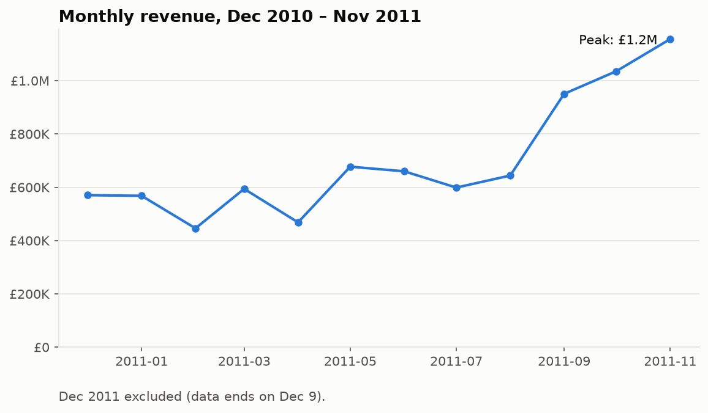
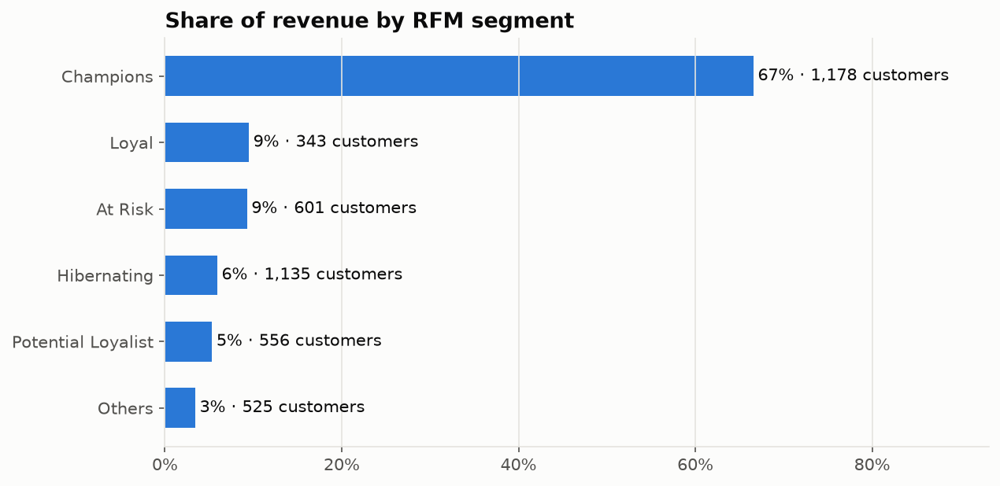
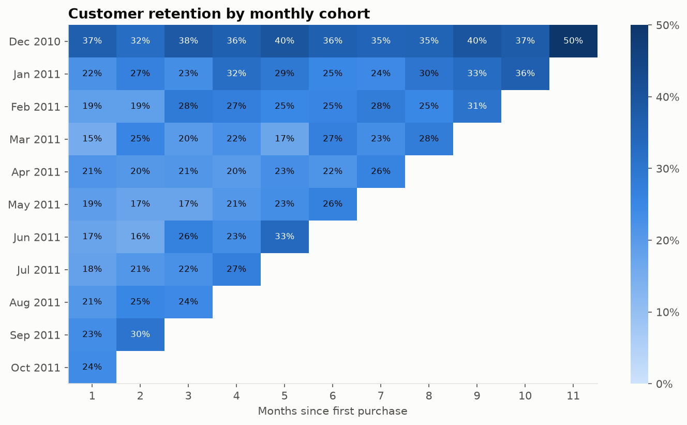
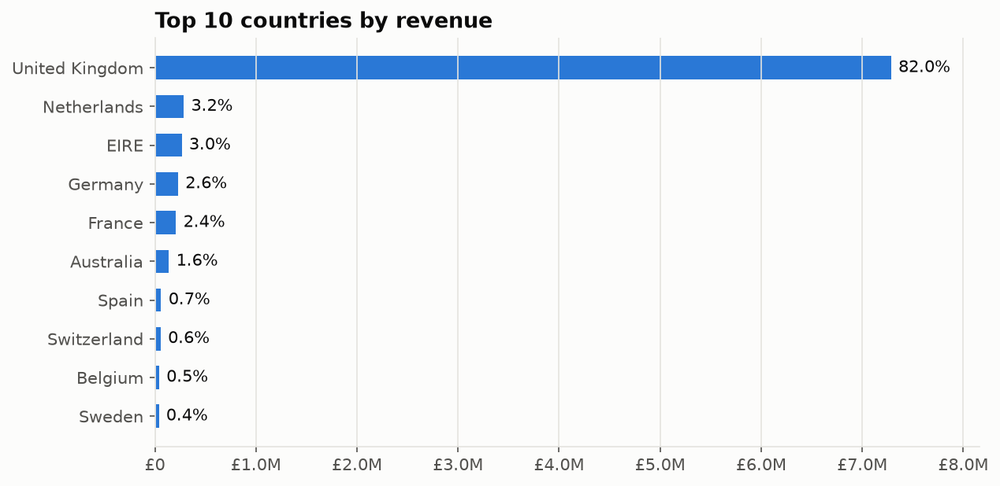

# Analysis summary

> Auto-generated by `python -m retail_analytics.pipeline`. Do not edit by hand.

**Period:** 2010-12-01 → 2011-12-09 · **Revenue:** £8,887,209 · **Orders:** 18,532 · **Customers:** 4,338

## Key findings

- **Revenue is concentrated:** the top 10% of customers generate **61%** of revenue.
- **Retention is the main lever:** on average only **21%** of a cohort buys again the month after its first purchase, and **34%** of customers bought only once.
- **Single-market dependency:** the United Kingdom accounts for **82%** of revenue.

## RFM segments

| Segment | Customers | Avg recency (days) | Avg orders | Avg spend | Revenue share |
|---|---:|---:|---:|---:|---:|
| Champions | 1,178 | 14 | 9.7 | £5,022 | 66.6% |
| Loyal | 343 | 48 | 5.6 | £2,459 | 9.5% |
| At Risk | 601 | 155 | 3.6 | £1,373 | 9.3% |
| Hibernating | 1,135 | 211 | 1.2 | £463 | 5.9% |
| Potential Loyalist | 556 | 17 | 1.7 | £852 | 5.3% |
| Others | 525 | 54 | 1.5 | £580 | 3.4% |

## Data quality

| Check | Rows |
|---|---:|
| rows_in | 541,909 |
| duplicates | 5,268 |
| cancellations | 9,251 |
| missing_customer_id | 134,658 |
| non_positive_quantity_or_price | 40 |
| rows_out | 392,692 |

## Charts

